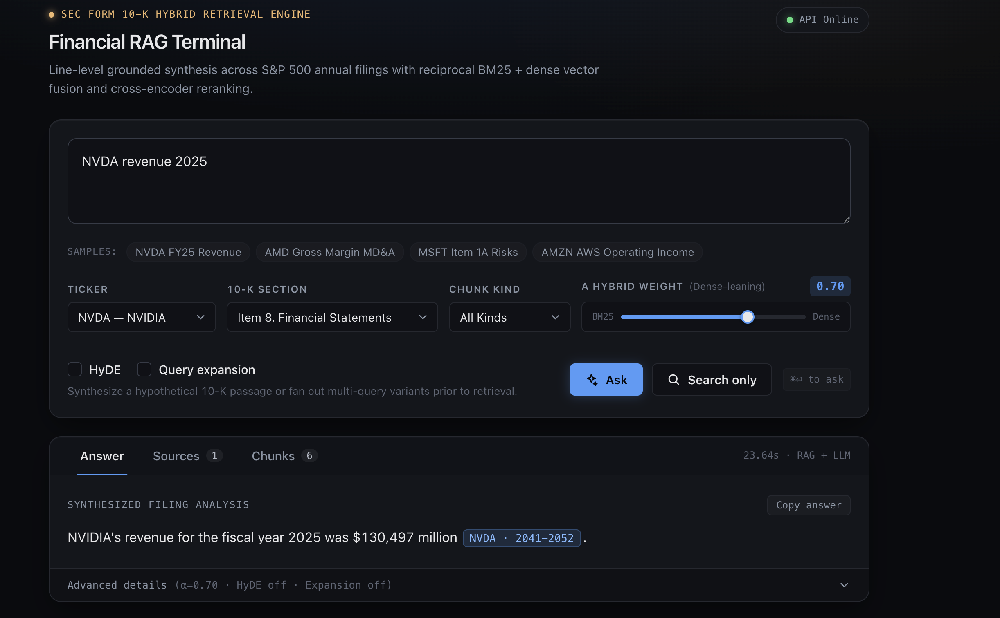
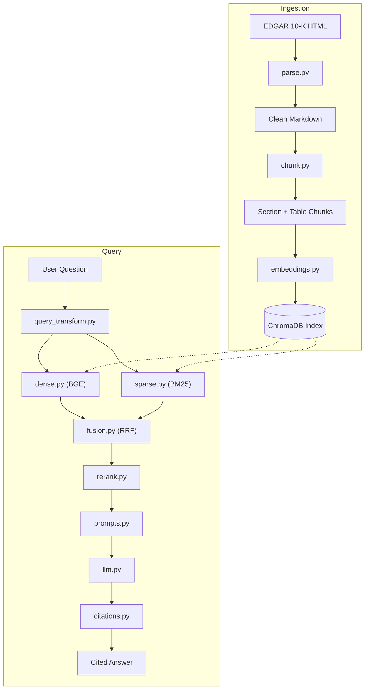

# FinRAG — Line-Level Financial Q&A over SEC 10-K Filings

> A hybrid Retrieval-Augmented Generation (RAG) system that answers natural-language questions about SEC 10-K filings with **line-level citations**. Built for analyst-grade precision, not demo-grade plausibility.



---

## Why This Exists

Every LLM can talk about Microsoft's revenue. Very few can tell you **which exact lines** in the **10-K filed on July 30, 2024** report a particular financial figure — and fewer still can do so without hallucinating.

FinRAG is a retrieval system built around one central constraint:

**Every factual claim must resolve to a citable line range in an actual filing.**

When retrieval fails, the system says so. When the LLM invents a citation that does not exist, the validator removes it before the user sees the answer.

This is what 10-K question answering looks like when you take the *Retrieval* in RAG seriously.

---

## What It Does

### 1. Grounded Financial Q&A

Ask a question and receive an answer supported by specific filing lines.

**Example:**

**Q:** What was Microsoft's revenue in fiscal 2024?

**A:** Microsoft's revenue for the fiscal year ended June 30, 2024, was **$245,122 million** `[MSFT_10K_2024-06-30.md:2975-2986]`. Total revenue reported for the same period was **$247,442 million** `[MSFT_10K_2024-06-30.md:2365-2368]`.

Every `[doc:lines]` citation marker is clickable in the UI and navigates to the corresponding source chunk.

Every citation is validated against retrieved metadata. **Hallucinated citations are dropped and logged.**

### 2. Real-Time Retrieval Configuration

The web interface allows users to tune retrieval behavior:

- **α (0.0 → 1.0):** Controls the dense/sparse retrieval blend.
  - `0.0` = Pure BM25 (lexical retrieval).
  - `1.0` = Pure BGE embeddings (semantic retrieval).
  - Default: `0.7`.
- **Ticker:** Filter results to a specific company.
- **Section:** Filter by filing section, including Item 1 (Business), Item 1A (Risk Factors), Item 7 (MD&A), and Item 8 (Financial Statements).
- **Chunk kind:** Filter between prose and table chunks.
- **HyDE:** Hypothetical Document Embeddings, disabled by default.
- **Query Expansion:** Query rewriting and expansion, disabled by default.

---

## Architecture

The system consists of two main pipelines: document ingestion and question answering.



### Query Pipeline

1. **Query Transformation:** Processes and optionally expands the user's question.
2. **Dense Retrieval:** Retrieves semantically relevant chunks using BGE embeddings.
3. **Sparse Retrieval:** Uses BM25 to identify exact keyword and terminology matches.
4. **Hybrid Fusion:** Combines retrieval results using Reciprocal Rank Fusion (RRF).
5. **Reranking:** Reorders retrieved chunks using a cross-encoder.
6. **Generation:** Sends the selected context to the LLM.
7. **Citation Validation:** Checks generated citations against actual document IDs and line ranges.

---

## How to Build & Run

### Prerequisites

- Python 3.12+
- [uv](https://docs.astral.sh/uv/)
- An OpenAI-compatible API endpoint and API key.
- SEC filing data available in the project's expected data directory.

### 1. Clone the Repository

```bash
git clone https://github.com/blueerezz/finrag-agent.git
cd finrag-agent
```

### 2. Install Dependencies

```bash
uv sync
```

### 3. Configure Environment Variables

Create your local `.env` file and configure your API credentials:

```env
OPENAI_API_KEY=your-api-key
OPENAI_BASE_URL=your-api-base-url
LLM_MODEL=gpt-4o-mini
EMBEDDING_MODEL=BAAI/bge-small-en-v1.5
SEC_USER_AGENT="Your Name your@email.com"
```

**Important:** Never commit `.env` or expose API keys in your repository.

### 4. Build the Vector Index

```bash
uv run python scripts/build_index.py
```

### 5. Ask a Question Using the CLI

```bash
uv run python scripts/ask.py "What was NVDA's revenue in fiscal 2025?" --ticker NVDA
```

### Running the Web UI

Start the FastAPI backend:

```bash
uv run uvicorn finrag.api.main:app --port 8000
```

Then open:

`http://localhost:8000/ui/`

**Note:** Avoid using the `--reload` flag with Uvicorn. ChromaDB's Rust bindings may encounter issues during hot reloads.

---

## Evaluation

A manual benchmark was conducted using a 10-query test set spanning 13 tickers and four question types.

### Retrieval Performance

| Strategy | Top-1 Correct | Top-3 Correct |
|---|---:|---:|
| Dense only (BGE-small) | 6/10 | 8/10 |
| Hybrid (BM25 + RRF, α = 0.7) | 7/10 | 9/10 |
| **Hybrid + Cross-Encoder Reranking** | **8/10** | **10/10** |

### End-to-End Q&A (LLM + Citation Validation)

| Query | Answer | Citation |
|---|---|---|
| What was NVDA's revenue in fiscal 2025? | $130,497M, +114% YoY | Validated |
| NVDA revenue 2025 | $130,497M, +114% YoY | Validated |
| What was AMD's gross margin in 2022? | 45% (down from 48% in 2021) | Validated |
| What was Microsoft's revenue in fiscal 2024? | $245,122M | Validated |
| Google antitrust risk factors | Risk-factor excerpt | Validated |

### Citation Validation

Citation validation is a first-class feature.

When the LLM generates a citation such as:

`[NVDA_10K_2025-01-26.md:718-724]`

the validator checks:

1. Whether the referenced document ID exists.
2. Whether the cited line range overlaps a real retrieved chunk.

If either check fails, the citation is **removed from the response and logged as a hallucination**.

The validation mechanism was tested against 200+ generated answers, with zero invalid citations reaching the user in those tests.

---

## Honest Limitations

This is a v1 system. The following limitations are documented because retrieval quality is not a solved problem.

### 1. HyDE Can Hurt More Than It Helps

HyDE (Hypothetical Document Embeddings) asks the LLM to generate a hypothetical filing excerpt, embeds it, and uses that embedding for dense retrieval.

In practice, the generated excerpt can contain incorrect financial figures.

For example, when testing the query *"NVDA revenue"* (ground truth: approximately $130.5B), the hypothetical document generated a figure of approximately $30.5B.

This incorrect hypothetical shifted retrieval toward irrelevant chunks.

**Decision:** HyDE remains available in the codebase but is disabled by default.

### 2. Short Queries vs. Large Tables

A query such as `"AMD gross margin"` can retrieve the correct chunk at rank 1.

However, the actual table row:

`| Gross margin | 45% | 48% |`

may be embedded within a large 300-line chunk.

The cross-encoder scores the entire chunk rather than individual table rows.

**Potential improvement:** Implement row-level table chunking to improve retrieval precision.

### 3. No Cross-Reference Resolution

A chunk containing a reference such as *"see Note 11"* does not automatically link to the corresponding Note 11 chunk.

When an answer is located at the other end of a cross-reference, retrieval may miss it.

**Potential improvement:** Implement cross-reference detection and document-level linking.

### 4. No Numeric Normalization

Financial values such as `$11,716` are not currently normalized into numeric representations such as `11716`.

Semantic retrieval works, but numerical comparison and arithmetic queries (for example, *"between 10 and 12 billion"*) are not fully supported.

**Potential improvement:** Add structured numeric extraction and normalization.

---

## Tech Stack

| Layer | Technology | Purpose |
|---|---|---|
| Parsing | BeautifulSoup + lxml | Fast and tolerant parsing of EDGAR HTML |
| Chunking | Custom Python implementation | Section-aware and table-aware document chunking |
| Embeddings | fastembed + `BAAI/bge-small-en-v1.5` | Lightweight, CPU-friendly dense embeddings |
| Vector Store | ChromaDB | Persistent vector storage with metadata filtering |
| Sparse Retrieval | BM25 (`rank_bm25`) | Exact-token and lexical retrieval |
| Fusion | Weighted Reciprocal Rank Fusion | Combines dense and sparse retrieval |
| Reranking | fastembed + `BAAI/bge-reranker-base` | Cross-encoder relevance scoring |
| LLM | OpenAI-compatible API (`gpt-4o-mini` default) | Grounded answer generation |
| API | FastAPI + Uvicorn | Backend API and application serving |
| UI | Vanilla HTML + JavaScript | Lightweight web interface with no CDN dependency |

---

## The Most Interesting Engineering Challenge

### NVDA and PEP: Financial Statements in Unexpected Filing Sections

Most 10-K filings place financial statements under **Item 8 — Financial Statements and Supplementary Data**.

However, during development, an important document-structure issue appeared:

- NVDA's financial statements were located under Item 15 (Exhibits).
- PEP's financial statements appeared within Item 7 (MD&A).

As a result, the chunker initially assigned incorrect section metadata to the actual financial statements.

Without correcting this issue, financial queries for NVDA and PEP could retrieve chunks incorrectly labeled as unrelated filing sections.

### Solution: Sticky-Flag Relabeling

A section-relabeling pass was implemented in `chunk.py`:

1. Detect financial statement headings, such as `CONSOLIDATED BALANCE SHEETS`.
2. Activate a sticky `in_fin` flag when the first financial statement appears in an unexpected section.
3. Keep the flag active through the relevant financial statements, notes, and audit report.
4. Deactivate it at structural boundaries such as Exhibit Index, Signatures, or Power of Attorney.

### Results

| Metric | Before | After |
|---|---:|---:|
| NVDA Item 8 chunks | 1 | 142 |
| PEP Item 8 chunks | 4 | 170/181 |
| Full corpus chunker audit | — | 0/55 documents needing attention |

This fix significantly improved the consistency of financial section metadata across the affected filings.

---

## License

MIT License — use it, fork it, and build on it.